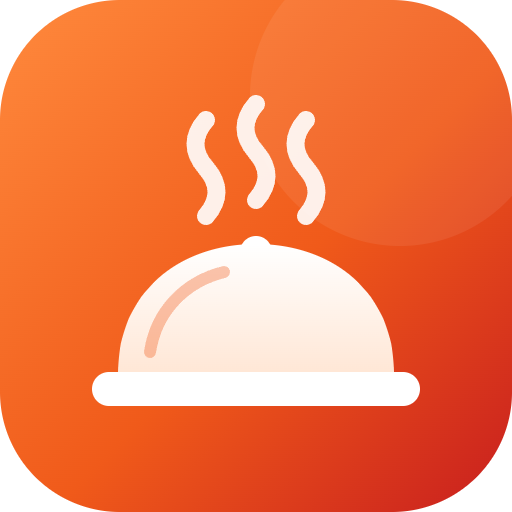
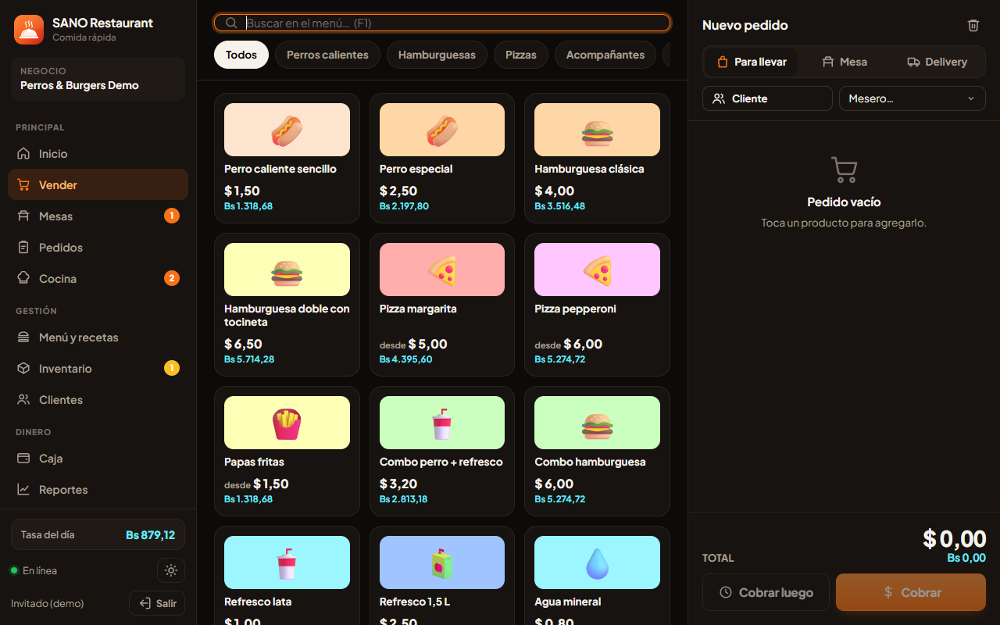
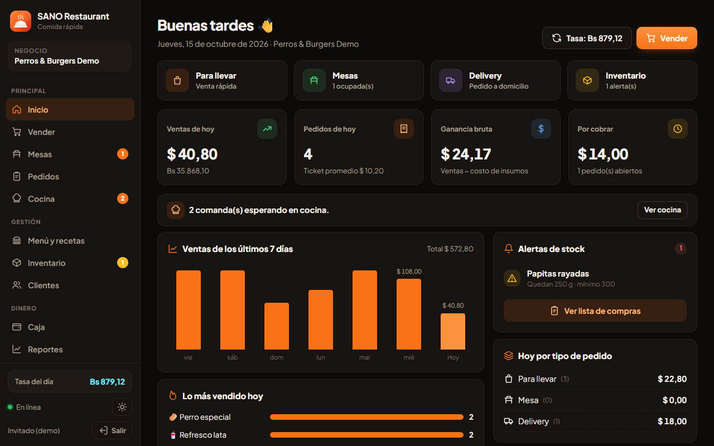
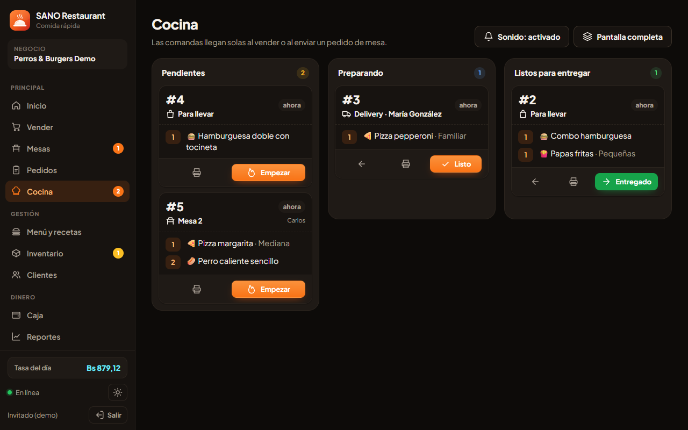
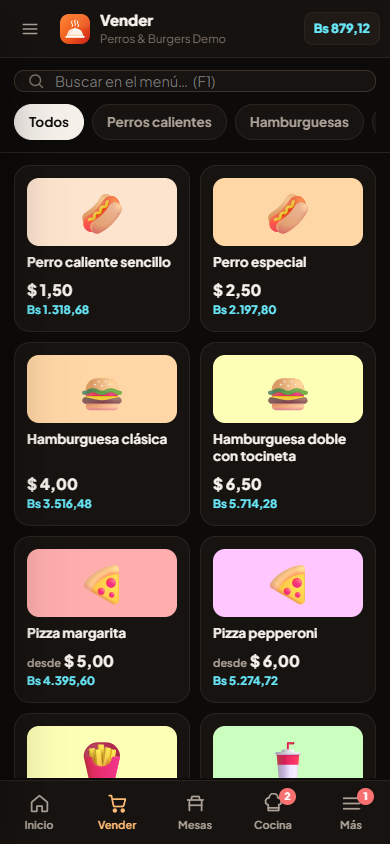
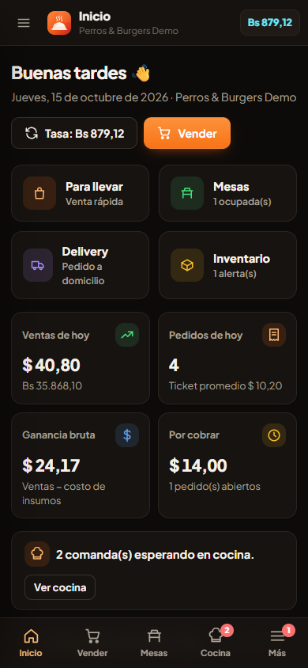
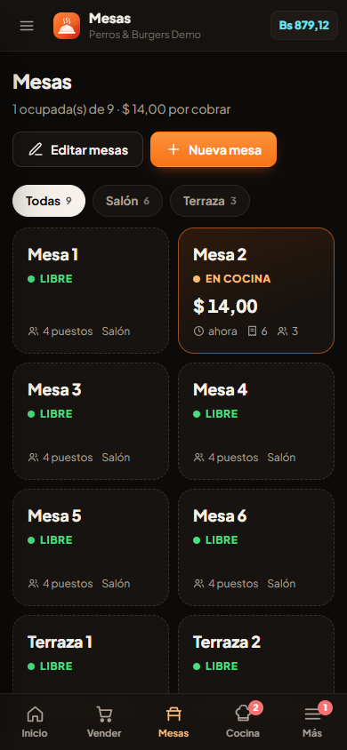
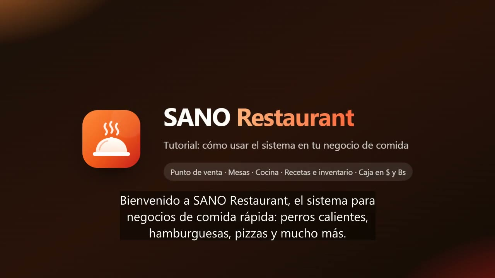
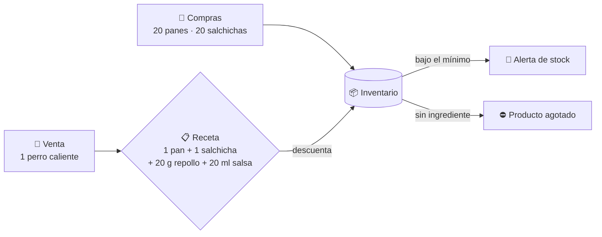

<div align="center">



# SANO Restaurant

**Punto de venta para comida rápida en Venezuela: inventario por recetas, mesas, cocina y caja en $ y Bs.**

Perros calientes, hamburguesas, pizzas, arepas, pepitos, combos, bebidas… todo en un solo sistema que se instala desde el navegador.

[](https://sano-restaurant.web.app)
[](https://sano-restaurant.web.app/tutorial/sano-restaurant-tutorial.mp4)
[](https://wa.me/584221906045)


</div>

---

## ✨ Capturas

<div align="center">



| Inicio | Cocina |
|:---:|:---:|
|  |  |

| Vender (teléfono) | Inicio (teléfono) | Mesas (teléfono) |
|:---:|:---:|:---:|
|  |  |  |

</div>

## 🎬 Video tutorial

<a href="https://sano-restaurant.web.app/tutorial/sano-restaurant-tutorial.mp4">
  
</a>

Recorrido de 5 minutos con voz en español venezolano y subtítulos: recetas, inventario, una venta y cómo bajan los ingredientes, mesas, cocina, delivery, caja, reportes e instalación en el teléfono.

## 🚀 Pruébalo

1. Entra en **https://sano-restaurant.web.app**.
2. Toca **Probar demo gratis**. Se crea un negocio de ejemplo con menú, mesas, clientes, ventas y comandas.
3. Un **recorrido guiado** ilumina cada zona y explica para qué sirve.
4. El **PIN de la demo es `1234`**. Te deja entrar a Reportes, anular ventas, etc.

> La demo dura 30 minutos, está aislada del resto y se borra sola al terminar.

## 🍔 Inventario por recetas

Cada producto dice qué ingredientes consume. Al cobrar, el sistema los descuenta solo.



- **Tamaños**: cada tamaño tiene su propio precio y su propia receta (por ejemplo, pizza personal con 180 g de masa y familiar con 450 g).
- **Extras**: "Extra queso +$0,50" descuenta una rebanada más.
- **Reventa**: refrescos y agua descuentan 1 unidad.
- **Unidades**: convierte entre g ↔ kg y ml ↔ L.
- **Costo y ganancia por venta**: usa el costo promedio de cada compra.
- **Anular una venta** devuelve los ingredientes al inventario.

## 🧩 Funciones

| Sección | Qué hace |
|---|---|
| 🏠 **Inicio** | Ventas y ganancia del día, pedidos por cobrar, alertas, gráfico de 7 días y lo más vendido |
| 💳 **Vender** | Para llevar, mesa o delivery; tamaños, extras y notas; pagos mixtos en $ y Bs; vuelto en cualquier moneda; propina opcional |
| 🪑 **Mesas** | Plano por zonas (libre, en cocina, para servir); varias rondas; pre-cuenta; cambiar de mesa; agregar, editar o quitar mesas |
| 🧾 **Pedidos** | Pedidos abiertos (cobrar luego y delivery), ventas por fecha, reimprimir y anular con PIN |
| 👨‍🍳 **Cocina** | Comandas: Pendiente → Preparando → Listo → Entregado, con tiempos y sonido |
| 📋 **Menú y recetas** | Productos, precios, recetas, tamaños, extras, foto o emoji, margen y cuántos se pueden preparar |
| 📦 **Inventario** | Insumos, compras, mermas, conteos, movimientos y lista de compras por WhatsApp |
| 👥 **Clientes** | Datos de delivery, visitas, consumo, historial y WhatsApp |
| 💰 **Caja** | Apertura y cierre por turno con arqueo en $ y Bs, gastos e ingresos, totales por forma de pago (descontado el vuelto) |
| 📊 **Reportes** | Ventas, ganancia, horas pico, formas de pago, productos, insumos y gastos. Se exportan a Excel (CSV) o se imprimen. Piden PIN |
| ⚙️ **Configuración** | Datos y recibo, tasa BCV automática o manual, IVA, delivery, zonas, meseros, PIN y respaldo |
| ❓ **Ayuda** | Recorridos guiados por sección y video tutorial |

**Formas de pago:** efectivo en $, efectivo en Bs, punto de venta, pago móvil, transferencia, biopago y Zelle.
**Tasa del día:** se consulta la tasa oficial BCV cada mañana y se puede escribir una manual en cualquier momento.

## 🏢 Multisede y panel de administración

- Viene con **20 sedes** listas, y se pueden crear más.
- Desde el panel de administración puedes:
  - crear, editar, **congelar** (con motivo), reactivar, **renovar 30 días**, eliminar y restaurar sedes;
  - entrar a cualquier sede y reiniciar su PIN;
  - enviar el acceso por WhatsApp;
  - publicar un **aviso general** para todas las sedes;
  - exportar la lista de sedes.
- Cuando vence la fecha de pago, la sede **se bloquea sola**. Las reglas de Firestore lo hacen cumplir también en el servidor.

## 📲 Instalar (sin tiendas ni descargas)

Es una **PWA**: la misma web se instala como app y se actualiza sola cada vez que se publica un cambio.

| Equipo | Cómo |
|---|---|
| **Android (Chrome)** | Botón **Instalar**, o menú ⋮ › *Instalar app* |
| **PC (Chrome o Edge)** | Botón **Instalar**, o el ícono de instalar en la barra de direcciones. Queda un acceso directo en el escritorio |
| **iPhone / iPad (Safari)** | Compartir › *Agregar a inicio* |

La app instalada funciona sin internet y sincroniza cuando vuelve la conexión. Imprime recibos y comandas en la impresora del equipo, y tiene accesos rápidos a Vender, Mesas, Cocina e Inventario.

## 🛠️ Tecnología

- **Frontend:** HTML, CSS y JavaScript con módulos ES, sin compilación. Modo claro y oscuro.
- **Firebase:** Hosting, Authentication (correo y contraseña, más una sesión anónima para la demo) y Firestore con caché sin conexión.
- **Datos:** cada sede guarda los suyos aislados en `tenants/{uid}/...`, protegidos por reglas de seguridad.
- **Pruebas:** Puppeteer contra los emuladores de Firebase.

```
public/                 App web (Firebase Hosting)
  js/store.js           Datos en tiempo real por sede y cálculo de recetas
  js/ops.js             Operaciones atómicas: cobrar, pedidos, cocina, anulaciones, caja, inventario
  js/charge.js          Ventana de cobro
  js/tour.js            Recorridos guiados y ayuda
  js/views/*.js         Secciones de la app y panel de administración
  tutorial/             Video tutorial
firestore.rules         Seguridad: sedes aisladas, congelación, vencimiento y demo
scripts/
  provision.mjs         Crea o actualiza sedes
  e2e.mjs               Prueba general (42 verificaciones)
  e2e-flows.mjs         Pedido completo para llevar, en mesa y delivery (47 verificaciones)
  prod-smoke.mjs        Prueba rápida en producción
  pwa-check.mjs         Verifica que la app se pueda instalar
  screens.mjs           Capturas de pantalla para el instalador
  tutorial/make-video.mjs  Genera el video tutorial (necesita ffmpeg y edge-tts)
```

## ⌨️ Comandos

```bash
# Publicar
firebase deploy --only hosting          # app (los equipos instalados se actualizan solos)
firebase deploy --only firestore        # reglas e índices

# Sedes
cd scripts && npm install && node provision.mjs 25   # crea sedes nuevas y conserva las que ya existen

# Pruebas locales (emuladores; Java requerido)
firebase emulators:start --only auth,firestore,hosting
sh scripts/test-emu.sh && node scripts/e2e-flows.mjs
```

> **Plan gratuito (Spark):** Firestore permite unas 20 000 escrituras y 50 000 lecturas al día para todo el proyecto. Una venta usa entre 5 y 12 escrituras, según los ingredientes. Con muchas sedes activas conviene el plan Blaze, en el que se paga solo lo que se usa.

> 🔒 Las contraseñas de las sedes (`CREDENCIALES_*.txt` y `scripts/.accounts.json`) **no se suben al repositorio**. Respáldalas aparte.

---

<div align="center">

**¿Quieres SANO Restaurant para tu negocio?**

[](https://wa.me/584221906045)

Hecho en Venezuela 🇻🇪 por **Sano Dev**

</div>
